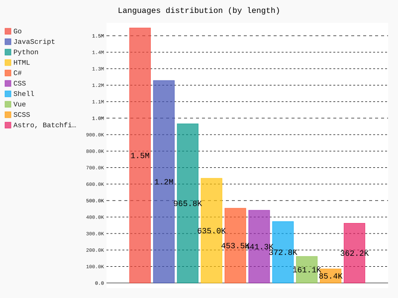

# Guionardo's github profile report

I am Guionardo, a passionate software developer and open source enthusiast.

---

---

---

---

## Monitored Organizations and Users

| Name | Type | Location | Description |
|----|-----|----|---|
|Projeto Escoteirando | Organization | Brazil | No description |
|Guionardo Furlan | User | Blumenau/SC/Brasil |  |

## Last Updated Repositories

| Repository | Description | Last Commit | Status |Languages|
|----|-----|----|---|---|
| [guionardofurlan.com.br](https://github.com/guionardo/guionardofurlan.com.br) | No description | <a href="https://api.github.com/repos/guionardo/guionardofurlan.com.br/git/commits/145423c243c5348e6683ab5159f2f5a1b5028e14" title="Guionardo Furlan @ 2026-10-27 01:06:14+00:00"><small>145423c2</small></a><pre>fix: initialize Google Analytics correctly</pre> | 🚀|Astro, HTML, TypeScript, JavaScript, Python, CSS, Makefile
| [go](https://github.com/guionardo/go) | Golang tools, examples, and packages | <a href="https://api.github.com/repos/guionardo/go/git/commits/1f7e0cf7e09132a0ae7c9caf5f2d00717093362f" title="Guionardo Furlan @ 2026-10-26 23:59:14+00:00"><small>1f7e0cf7</small></a><pre>feat(sqlite): delivery hardening — CGO-free CI, benchmarks, docs (v1.8 Phase 17) (#52)  * docs(17): capture phase context  * docs(state): record phase 17 context session  * docs(17): research delivery hardening phase  CGO-free matrix (job env + step-level cgo override for -race), coverage gate evidence, benchmark registration for sqlite, and doc/example/README targets.  * docs(17): create phase plans for delivery hardening  * docs(17): address checker feedback in phase 17 plans  * docs(17): create phase plan  * feat(17-01): make the CI test matrix prove a CGO-free build  - set job-level env CGO_ENABLED="0" on the three-OS test job so build,   unit tests and the two-process E2E all run without cgo (D-01) - add Build (CGO-free) step between Set up Go and Build swapper binaries:   shell bash (closes the pwsh last-exit-code fail-open), then   go env CGO_ENABLED -> go build ./... -> go vet ./... -> go list -m pins (D-03) - override CGO_ENABLED="1" on SQLite race detector only, keeping its   runner.os != 'Windows' gate, and rewrite its comment to record the   supersession: pure-Go driver, but -race is a cgo build mode (D-02/D-04) - leave Run tests, the E2E step and the separate coverage job untouched  * docs(17-01): complete CGO-free CI proof plan  - SUMMARY.md for the workflow change (QUAL-01): job-level CGO_ENABLED=0,   Build (CGO-free) step, single step-level race exception - records local reproduction (build/vet/suite/E2E/race probe/coverage) and   the out-of-scope coverage-job setup-go@v3 follow-up  * feat(17-02): register sqlite Memory and File families in BenchmarkBatch  - add path/filepath and cache/sqlite imports to the benchmark harness - BenchmarkBatch: b.Run("sqlite") with Memory (:memory:) and File (b.TempDir) families - each family delegates to runBatchBenchmarks with a distinct name (sqlite_memory, sqlite_file) - b.Cleanup(Close) registered after b.TempDir() so handles close before temp removal (LIFO) - no Docker gate; mem blocks, helpers, batchSizes and provider slice untouched  * feat(17-02): add BenchmarkPrimitives across mem and both sqlite modes  - const primitiveKeyRing = 1024 bounds key growth so file-mode Set measures   overwrite cost rather than b-tree growth - runPrimitiveBenchmarks runs Get/Set/Delete/GetOrSet arms against one provider,   passing b.Context() inline at every call site - BenchmarkPrimitives compares mem, sqlite/Memory and sqlite/File with   b.Cleanup(Close) registered after construction (LIFO, Windows-safe) - GetOrSet measures the warm fast-path; no Docker gate, no printed numbers  * docs(17-02): complete sqlite benchmark coverage plan  - SUMMARY.md with frontmatter actuals measured from the plan ledger (2 commits) - records QUAL-04 coverage: 48 batch + 12 primitive sub-benchmarks - no measured numbers published (D-08)  * docs(phase-17): update tracking after wave 1  * docs(17-03): document the sqlite batch surface in godoc and README  - cache/sqlite/doc.go: one batch paragraph inside the package comment —   MGet chunked IN with silent skips and partial-on-cancel, MSet one TTL   in a single BEGIN IMMEDIATE transaction with whole-batch rollback,   MDel chunked and idempotent - README.md: one mirrored batch sentence appended to the sqlite paragraph - four pre-existing doc topics (TTL, reopen persistence, :memory:,   multi-process envelope) re-verified against shipped code; unchanged  * test(17-03): add ExampleNew_withPath durability example  RED: go test ./cache/sqlite/ -run 'ExampleNew_withPath' -v printed 'testing: warning: no tests to run' (no --- PASS line) before this code. GREEN: --- PASS: ExampleNew_withPath, both examples pass under -run Example.  - writes through sqlite.WithPath into an os.MkdirTemp dir, Closes, reopens   the same path and Gets the value back (// Output: value: hello) - os.MkdirTemp + defer os.RemoveAll: no t.TempDir() (illegal in an example,   no *testing.T in scope) and no sqlite.WithName (would touch the user cache) - existing in-memory Example() untouched  * docs(17-03): record the QUAL-02 coverage audit with five-class mapping  - five named classes (unit, :memory:, reopen/persistence, concurrent,   sweep) mapped to the tests already shipping, each with a file.go:LINE   citation verified against this tree - verbatim make coverage-quick tail: all three threshold lines PASS,   total 82.1% (2628/3201), cache/sqlite 92.6% of statements - no-override proof: both coverage configs grep to 0 for cache/sqlite - D-13 rationale recorded (E2E merge stays ./cache/-rooted) and the   D-12/D-14 exclusions listed so neither is reopened later  * docs(17-03): complete sqlite docs and coverage-audit plan  - SUMMARY.md with TDD gate evidence, coverage metadata and self-check - STATE.md / ROADMAP.md intentionally untouched (orchestrator owns them)  * docs(phase-17): update tracking after wave 2  * docs(17): add code review report  * docs(17): record code review disposition  * fix(17): CR-01 fail primitive benchmarks on cache errors  runPrimitiveBenchmarks discarded every Get/Set/Delete/GetOrSet error. Since sqlite.New defers open failures to the first operation via initErr, an unusable cache benchmarked as tens of nanoseconds with no indication of failure.  Probe the provider once before timing (Set+Get) and check every operation in the hot loops via b.Fatal, matching runBatchBenchmarks. Sub-benchmark names and arm shapes are unchanged.  * fix(17): WR-03 assert the CGO-free proof instead of printing it  The Build (CGO-free) step only echoed go env CGO_ENABLED and go list -m output, so the phase's deliverable could silently regress. The step now exits non-zero when CGO_ENABLED is not 0 and fails when either modernc.org/sqlite or modernc.org/libc does not resolve to a pinned version. shell: bash and all four gate-grepped commands are preserved.  * docs(17): mark CR-01 and WR-03 fixed in review disposition  Two of eleven findings closed by 55b0f72 and ad010d2; open count 11 -> 9. Adds 17-REVIEW-FIX.md with per-finding changes and verification evidence.  * test(17): persist human verification items as UAT  * docs(phase-17): add security threat verification  * fix(17): build swapper binaries before the CGO-free build gate  The `Build (CGO-free)` step ran `go build ./...` on a clean checkout, where `release/embed_swapper.go`'s //go:embed patterns for `swapper/swapper_{linux,darwin,windows}_*` have no matching files yet — those are generated by `make swapper` in the following step. Ubuntu failed in 19s:    ##[error]release/embed_swapper.go:14:12: pattern swapper/swapper_darwin_amd64: no matching files found  Reproduced locally: `make swapper-clean && CGO_ENABLED=0 go build ./...` fails with the same message; `make swapper && CGO_ENABLED=0 go build ./...` passes, as does `go vet ./...`.  Moves `Build swapper binaries` ahead of `Build (CGO-free)`, still before `Run tests`, so the step's own ordering intent (D-03) holds while the embed dependency is satisfied. Comment records why the order is load-bearing.  Found by the Phase 17 UAT CI-matrix checkpoint (17-UAT.md test 1).  * test(17): complete UAT - 1 passed, 0 issues  * docs(phase-17): complete phase execution</pre> | 🚀|Go, Shell, Makefile
| [decision-stack](https://github.com/guionardo/decision-stack) | No description | <a href="https://api.github.com/repos/guionardo/decision-stack/git/commits/cc8fe9a1ac1eb7de19898af653a5d8cf1720e363" title="Guionardo Furlan @ 2026-10-23 14:49:19+00:00"><small>cc8fe9a1</small></a><pre>CI: baseUrl via quartz.config.ts (flag --base não existe)</pre> | 🚀|N/A
| [git-purge-branches](https://github.com/guionardo/git-purge-branches) | git tool to remove merged and deleted on remote branches | <a href="https://api.github.com/repos/guionardo/git-purge-branches/git/commits/f30c4ff2ae46604f681e5e462331e72f2f4f7402" title="Guionardo Furlan @ 2026-10-14 12:06:14+00:00"><small>f30c4ff2</small></a><pre>Initial commit</pre> | 🚀|N/A
| [guiosoft-k3s-lab](https://github.com/guionardo/guiosoft-k3s-lab) | No description | <a href="https://api.github.com/repos/guionardo/guiosoft-k3s-lab/git/commits/05bdd52c03d90f9be13093d347dd4d468e093aa5" title="Guionardo Furlan @ 2026-10-11 13:54:31+00:00"><small>05bdd52c</small></a><pre>docs(samba): record package installation and daemon activation state</pre> | 🚀|Shell, Python, Makefile, Go, HCL, Jinja, Dockerfile
| [gs-secrets](https://github.com/guionardo/gs-secrets) | Poor-man's secret vault: a single-file CLI to store and retrieve API keys, passwords, and other secrets in an AES-256-GCM encrypted local vault.  No cloud, no daemon, no dependencies beyond the Go standard library. Secrets expire on demand with a TTL. | <a href="https://api.github.com/repos/guionardo/gs-secrets/git/commits/33d22f3e942852cd7691c3be82f4fdfd78209f2f" title="Guionardo Furlan @ 2026-10-03 07:23:23+00:00"><small>33d22f3e</small></a><pre>chore: formalize changelog for v0.5.1</pre> | 🚀|Go, JavaScript, PowerShell, Makefile
| [homebrew-tap](https://github.com/guionardo/homebrew-tap) | No description | No commits | 🚀|N/A
| [ciclo](https://github.com/guionardo/ciclo) | ciclo — framework de IA para o ciclo de desenvolvimento (tasks → spec → código → review → deploy) | <a href="https://api.github.com/repos/guionardo/ciclo/git/commits/87e92f92d8faad99f2a25423552e515180a75209" title="Guionardo Furlan @ 2026-09-09 02:01:53+00:00"><small>87e92f92</small></a><pre>feat: replace Hermes with opencode as required dependency  - cliInstall.js: add opencode install spec (manual + auto per OS) - doctor.js: validate opencode via getCliPath instead of hermes - init.js: auto-install opencode in init (interactive or --yes) - welcome scripts: reference opencode as prerequisite - bump version to 0.1.2</pre> | 🦥|JavaScript, Shell, Makefile
| [guiosoft-scripts](https://github.com/guionardo/guiosoft-scripts) | Automation scripts for every day | <a href="https://api.github.com/repos/guionardo/guiosoft-scripts/git/commits/24681f9c52796bd4211bd180a93c0e9c5bc19412" title="guionardo @ 2026-08-26 13:29:45+00:00"><small>24681f9c</small></a><pre>[AUTO-COMMIT] Updated README.md software versions</pre> | 🦥|Shell, Python
| [mappa_api_client](https://github.com/escoteirando/mappa_api_client) | No description | <a href="https://api.github.com/repos/escoteirando/mappa_api_client/git/commits/1d436b80c788ea8e7a020f613f235c0d5add5135" title="Guionardo Furlan @ 2026-08-12 12:15:49+00:00"><small>1d436b80</small></a><pre>chore: atualiza Makefile para padrão da skill makefile (help agrupado)  - help com awk + grupos ##@ + descrições ## - check targets: gocheck, uvcheck, check-e2e-config - regex corrigido [a-zA-Z0-9_.-] p/ capturar targets com hífen no BSD awk - variáveis GO/UV/PYTEST com ?= - .PHONY por grupo</pre> | 🦥|Python, Go, Makefile

### Significant Languages

| Language | Repositories | Total Bytes | Greater Repo |
|---|---|---|---|
| Go | 27 | 1555915 | guionardo/go (405979) |
| Python | 25 | 952670 | guionardo/hbsis_kb (301978) |
| JavaScript | 27 | 759130 | guionardo/ciclo (214652) |
| C# | 15 | 453485 | guionardo/gs-loader (212556) |
| HTML | 20 | 438883 | guionardo/ambevtech-csharp (234849) |
| CSS | 11 | 432443 | guionardo/GitTrainingWall (305777) |
| Shell | 16 | 372421 | guionardo/guiosoft-k3s-lab (249025) |
| Vue | 11 | 161107 | escoteirando/escoteirando_fastapi (54948) |
| Astro | 1 | 69406 | guionardo/guionardofurlan.com.br (69406) |
| Batchfile, C, C++, Dockerfile, Elm, HCL, Java, Jinja, Jupyter Notebook, MDX, Makefile, Mako, PHP, Pascal, Perl, PowerShell, PureBasic, Ruby, SCSS, TypeScript, xBase | 45 | 298318 | None (0) |

---

## Daily joke from <a href="https://official-joke-api.appspot.com/">official-joke-api</a>

>Where do rabbits go after they get married?

>On a bunny-moon.

---

---

*Generated with [Guionardo's README Generator] @ 2026-10-27T04:37:11.947393+00:00 UTC*