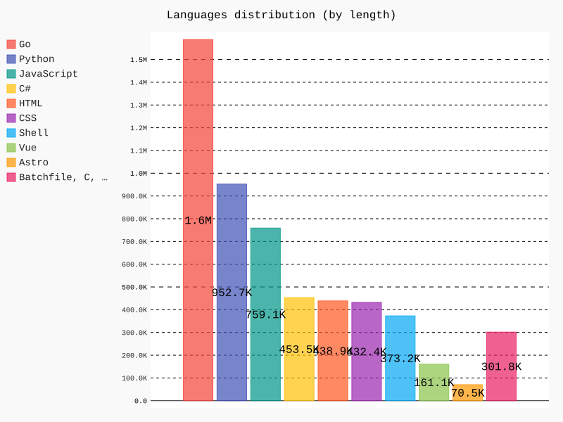

# Guionardo's github profile report

I am Guionardo, a passionate software developer and open source enthusiast.

---

---

---

---

## Monitored Organizations and Users

| Name | Type | Location | Description |
|----|-----|----|---|
|Projeto Escoteirando | Organization | Brazil | No description |
|Guionardo Furlan | User | Blumenau/SC/Brasil |  |

## Last Updated Repositories

| Repository | Description | Last Commit | Status |Languages|
|----|-----|----|---|---|
| [epharma-labs](https://github.com/guionardo/epharma-labs) | Projetos de laboratório para EPharma | <a href="https://api.github.com/repos/guionardo/epharma-labs/git/commits/d022ba78b6d0ead8cb681b29eefc2ffb67fb432f" title="Guionardo Furlan @ 2026-11-11 21:04:15+00:00"><small>d022ba78</small></a><pre>docs: update benchmark numbers from run</pre> | 🚀|C#
| [guiosoft-k3s-lab](https://github.com/guionardo/guiosoft-k3s-lab) | No description | <a href="https://api.github.com/repos/guionardo/guiosoft-k3s-lab/git/commits/3dc999098e3c283f906a04b2f0919c52787aabf3" title="Guionardo Furlan @ 2026-11-09 13:31:09+00:00"><small>3dc99909</small></a><pre>docs(articles): improve Ariadne description in Keycloak article</pre> | 🚀|Shell, Python, Makefile, Go, HCL, Jinja, Dockerfile
| [guionardofurlan.com.br](https://github.com/guionardo/guionardofurlan.com.br) | No description | <a href="https://api.github.com/repos/guionardo/guionardofurlan.com.br/git/commits/231a106f8fc3bb0513b65e0c9f2df6d74f2cec47" title="Guionardo Furlan @ 2026-11-06 23:28:27+00:00"><small>231a106f</small></a><pre>docs: document Docker registry TLS trust</pre> | 🚀|Astro, HTML, TypeScript, JavaScript, Python, CSS, Shell, Makefile
| [devcontainer-templates](https://github.com/guionardo/devcontainer-templates) | Reusable VS Code Dev Container templates for PHP 5.1.6, 5.4, and 8.5, with Apache, Xdebug, GHCR distribution, and verified breakpoint examples. | <a href="https://api.github.com/repos/guionardo/devcontainer-templates/git/commits/90a953562e5ca8dd04178ae4184e29a2bfabb1aa" title="Guionardo @ 2026-11-04 21:00:51+00:00"><small>90a95356</small></a><pre>release: consolidate PHP Dev Container templates v1.0.0</pre> | 🚀|JavaScript, Shell, Dockerfile, PHP
| [go](https://github.com/guionardo/go) | Golang tools, examples, and packages | <a href="https://api.github.com/repos/guionardo/go/git/commits/a473c6df64121ae1d7eb43faaf55e774e29aaaba" title="Guionardo Furlan @ 2026-10-27 13:09:07+00:00"><small>a473c6df</small></a><pre>docs(state): point at the next milestone and prune resolved blockers  Project Reference now reflects the v1.8 close; the blockers list drops the items closed at the close (DI-15-01, the Windows CI debug session, the seed, the 14 review findings, the six code bugs) and keeps the genuinely open ones (release path-traversal hardening, Windows -race, two Phase 10 deferrals). The audit file leaves the planning root, archived under milestones/.</pre> | 🚀|Go, Shell, Makefile
| [decision-stack](https://github.com/guionardo/decision-stack) | No description | <a href="https://api.github.com/repos/guionardo/decision-stack/git/commits/cc8fe9a1ac1eb7de19898af653a5d8cf1720e363" title="Guionardo Furlan @ 2026-10-23 14:49:19+00:00"><small>cc8fe9a1</small></a><pre>CI: baseUrl via quartz.config.ts (flag --base não existe)</pre> | 🚀|N/A
| [git-purge-branches](https://github.com/guionardo/git-purge-branches) | git tool to remove merged and deleted on remote branches | <a href="https://api.github.com/repos/guionardo/git-purge-branches/git/commits/f30c4ff2ae46604f681e5e462331e72f2f4f7402" title="Guionardo Furlan @ 2026-10-14 12:06:14+00:00"><small>f30c4ff2</small></a><pre>Initial commit</pre> | 🚀|N/A
| [gs-secrets](https://github.com/guionardo/gs-secrets) | Poor-man's secret vault: a single-file CLI to store and retrieve API keys, passwords, and other secrets in an AES-256-GCM encrypted local vault.  No cloud, no daemon, no dependencies beyond the Go standard library. Secrets expire on demand with a TTL. | <a href="https://api.github.com/repos/guionardo/gs-secrets/git/commits/33d22f3e942852cd7691c3be82f4fdfd78209f2f" title="Guionardo Furlan @ 2026-10-03 07:23:23+00:00"><small>33d22f3e</small></a><pre>chore: formalize changelog for v0.5.1</pre> | 🦥|Go, JavaScript, PowerShell, Makefile
| [homebrew-tap](https://github.com/guionardo/homebrew-tap) | No description | No commits | 🦥|N/A
| [ciclo](https://github.com/guionardo/ciclo) | ciclo — framework de IA para o ciclo de desenvolvimento (tasks → spec → código → review → deploy) | <a href="https://api.github.com/repos/guionardo/ciclo/git/commits/87e92f92d8faad99f2a25423552e515180a75209" title="Guionardo Furlan @ 2026-09-09 02:01:53+00:00"><small>87e92f92</small></a><pre>feat: replace Hermes with opencode as required dependency  - cliInstall.js: add opencode install spec (manual + auto per OS) - doctor.js: validate opencode via getCliPath instead of hermes - init.js: auto-install opencode in init (interactive or --yes) - welcome scripts: reference opencode as prerequisite - bump version to 0.1.2</pre> | 🦥|JavaScript, Shell, Makefile

### Significant Languages

| Language | Repositories | Total Bytes | Greater Repo |
|---|---|---|---|
| Go | 27 | 1587560 | guionardo/go (437624) |
| Python | 25 | 952674 | guionardo/hbsis_kb (301978) |
| JavaScript | 28 | 770302 | guionardo/ciclo (214652) |
| C# | 16 | 534367 | guionardo/gs-loader (212556) |
| HTML | 20 | 438883 | guionardo/ambevtech-csharp (234849) |
| CSS | 11 | 432443 | guionardo/GitTrainingWall (305777) |
| Shell | 18 | 407568 | guionardo/guiosoft-k3s-lab (273230) |
| Vue | 11 | 161107 | escoteirando/escoteirando_fastapi (54948) |
| Astro | 1 | 70539 | guionardo/guionardofurlan.com.br (70539) |
| Batchfile, C, C++, Dockerfile, Elm, HCL, Java, Jinja, Jupyter Notebook, MDX, Makefile, Mako, PHP, Pascal, Perl, PowerShell, PureBasic, Ruby, SCSS, TypeScript, xBase | 46 | 307757 | None (0) |

---

Could not fetch a joke at this time.

---

---

*Generated with [Guionardo's README Generator] @ 2026-11-13T19:28:32.374316+00:00 UTC*